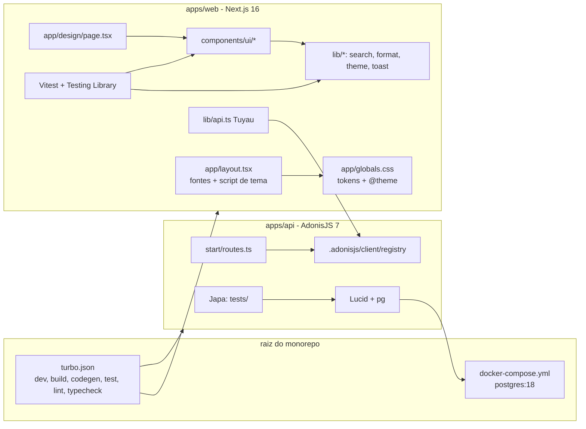

# Fundação do monorepo Design

**Spec**: `.specs/features/01-foundation/spec.md`
**Status**: Approved - abordagem confirmada pelo usuário em 2026-11-10 (tema por script inline, escala padrão de espaçamento, Radix direto, `.gitignore` no commit da estrutura)

---

## Architecture Overview

O monorepo parte do starter kit API Monorepo do AdonisJS v7 (Turborepo, workspaces npm, Tuyau já configurado), com as apps renomeadas para `apps/api` e `apps/web` (AD-001). O web é um Next.js 16 (App Router) que importa o registro de rotas da API como pacote do workspace para ter o cliente tipado. Os tokens do design system viram variáveis CSS lidas pelo Tailwind v4. O tema é aplicado por um script inline antes da primeira pintura, lendo o cookie `theme`, para o HTML continuar estático. Os componentes interativos usam primitivas Radix (AD-002); os demais são componentes React próprios. As regras que mudam o que o leitor vê (comparação da busca, contagens, formatação, fila de toasts, leitura do cookie) ficam em `src/lib/`, cobertas por testes unitários.



```mermaid
sequenceDiagram
  participant B as Navegador
  participant S as Next.js (HTML estático)
  participant Sc as Script inline no head
  participant R as React (hidratação)
  B->>S: GET /design (cookie theme=dark)
  S-->>B: HTML igual para todos, sem data-theme
  B->>Sc: executa antes da primeira pintura
  Sc->>B: html[data-theme=dark]
  B->>B: pinta com os tokens escuros
  R->>B: hidrata; ThemeSwitcher lê o cookie e marca "Escuro"
  Note over B,R: Ao trocar o tema: grava o cookie e muda data-theme na hora
```

---

## Code Reuse Analysis

### Existing Components to Leverage

| Component | Location | How to Use |
| --------- | -------- | ---------- |
| Starter kit API Monorepo | `npm create adonisjs@latest -- --kit=api-monorepo` | Base de `package.json`, `turbo.json`, `apps/api` (auth, Japa, Tuyau, lint, typecheck) |
| Export do registro Tuyau | `apps/api/package.json` (`./registry`, `./data`) | O web importa `@estanteca/api/registry` em `lib/api.ts` |
| Conexão `pg` comentada | `apps/api/config/database.ts` | Vira a conexão padrão; a SQLite sai |
| `.env.test` do kit | `apps/api/.env.test` | Recebe `PG_DB_NAME=estanteca_test` |
| Design system Estanteca | artefato `3wJJghiug3NRiRHqpu1NmW` | `tokens.json` copiado para `apps/web/src/styles/design-tokens.json`; markup, classes e textos dos componentes servem de referência para os componentes React |
| `create-next-app` | Next.js 16 | Gera `apps/web` (TypeScript, App Router, `src/`, Tailwind v4, ESLint) |

### Integration Points

| System | Integration Method |
| ------ | ------------------ |
| API ↔ web | Dependência de workspace `@estanteca/api`; `createTuyau({ baseUrl: NEXT_PUBLIC_API_URL, registry })` |
| API ↔ PostgreSQL | Lucid com `client: 'pg'`, variáveis `PG_*` validadas em `start/env.ts` |
| Turborepo ↔ web | Scripts `dev`, `build`, `test`, `lint`, `typecheck` do web; `typecheck` depende de `^build`, que gera o registro da API |

---

## Components

### Estrutura do monorepo

- **Purpose**: Raiz com workspaces, Turborepo e banco local.
- **Location**: `package.json`, `turbo.json`, `docker-compose.yml`, `docker/postgres/init/01-create-test-db.sql`, `scripts/smoke-dev.mjs`
- **Interfaces**:
  - `npm run dev | build | codegen | test | lint | typecheck` - via Turborepo, nas duas apps
  - `docker compose up -d` - PostgreSQL 18 em `localhost:5432`, volume `pgdata:/var/lib/postgresql`, bancos `estanteca` e `estanteca_test`
  - `node scripts/smoke-dev.mjs` - sobe `npm run dev`, espera `:3333` e `:3000` responderem 200 (até 120 s), imprime `dev ok: api 200, web 200` e encerra
- **Dependencies**: Node 24, npm 12, Docker
- **Reuses**: `package.json` e `turbo.json` do kit; remove `pnpm-workspace.yaml` e `.yarnrc.yml` (só npm)

### apps/api

- **Purpose**: API do kit, agora em PostgreSQL.
- **Location**: `apps/api/` (pacote `@estanteca/api`)
- **Interfaces**:
  - `GET /` → `200 { hello: 'world' }` (do kit)
  - Rotas de auth do kit (`/api/v1/auth/*`, `/api/v1/account/*`) sem mudança
- **Dependencies**: `pg` (entra), `better-sqlite3` (sai)
- **Reuses**: tudo do kit; testes novos em `tests/functional/` e `tests/unit/`

### Tokens e tema

- **Purpose**: Tokens do design system como variáveis CSS e utilitários Tailwind, nos três modos de tema.
- **Location**: `apps/web/src/app/globals.css`, `apps/web/src/styles/tokens.css`, `apps/web/src/styles/design-tokens.json`
- **Interfaces**:
  - Cores: `--color-<nome>` em `@theme` (ex.: `--color-surface`, `--color-status-read-soft`), redefinidas em `:root[data-theme="dark"]` e em `@media (prefers-color-scheme: dark) { :root:not([data-theme="light"]) }` → `bg-surface`, `text-ink-muted`
  - Raios: `--radius-cover`, `--radius-sm`, `--radius-md`, `--radius-full` → `rounded-cover` etc.
  - Sombras: `--shadow-cover`, `--shadow-raised`, `--shadow-focus-ring`, redefinidas no escuro → `shadow-cover` etc.
  - Espaçamento: ver Tech Decisions (escala padrão de 4px do Tailwind)
  - Fontes: `--font-serif`, `--font-sans`, `--font-mono` apontando para as variáveis do `next/font`
- **Dependencies**: `tailwindcss`, `@tailwindcss/postcss`
- **Reuses**: `design-tokens.json` é cópia exata do `tokens.json` v1 do design system; um teste compara os dois

### Fontes

- **Purpose**: Literata, Geist e Geist Mono servidas pelo app.
- **Location**: `apps/web/src/app/fonts.ts`
- **Interfaces**: `literata`, `geist`, `geistMono` de `next/font/google`, com `variable: '--font-literata' | '--font-geist' | '--font-geist-mono'` e `display: 'swap'`; Literata com `axes: ['opsz']`
- **Dependencies**: `next/font` (baixa no build e serve do próprio domínio)

### Tema (`lib/theme.ts` + `ThemeSwitcher`)

- **Purpose**: Ler, aplicar e gravar a preferência de tema.
- **Location**: `apps/web/src/lib/theme.ts`, `apps/web/src/components/theme-switcher.tsx`
- **Interfaces**:
  - `type ThemePreference = 'light' | 'dark' | 'system'`
  - `parseTheme(value: string | undefined): ThemePreference` - qualquer coisa fora dos três vira `system`
  - `THEME_SCRIPT: string` - script inline do `<head>`: lê o cookie, aplica `data-theme` só para `light`/`dark`
  - `applyTheme(pref: ThemePreference): void` - grava `theme=<pref>; path=/; max-age=31536000; samesite=lax` e ajusta `data-theme` (remove para `system`)
  - `<ThemeSwitcher />` - grupo de rádios "Claro", "Escuro", "Automático"
- **Reuses**: padrão "Preventing flash before hydration" da documentação do Next.js 16

### Componentes de interface (19)

- **Purpose**: Os componentes do design system em React + Tailwind.
- **Location**: `apps/web/src/components/ui/<nome>.tsx`, com `<nome>.test.tsx` ao lado
- **Interfaces**: as props dos tipos do design system (`index.d.ts` do artefato), em TypeScript: `Button`, `ActionMenu`, `TextField`, `FilterChip`, `Stepper`, `SideNav`, `BottomNav`, `SearchTrigger`, `SearchDialog`, `BookCover`, `BookCard`, `Shelf`, `StatusChip`, `Rating`, `ProgressBar`, `Stat`, `EmptyState`, `Toast` (+ `Toaster` e `toast()`), `Skeleton`
- **Dependencies**: `radix-ui` (DropdownMenu no ActionMenu, Dialog no SearchDialog, Toast no Toast, Tooltip na SideNav recolhida; AD-003), `lucide-react` (ícones)
- **Reuses**: markup, textos e regras de acessibilidade do `bundle.js` do design system; utilitário `cn()` local em `lib/cn.ts`

### Regras de interface (`lib/`)

- **Purpose**: Regras que mudam o que o leitor vê, testáveis sem renderizar.
- **Location**: `apps/web/src/lib/`
- **Interfaces**:
  - `search.ts`: `normalize(text: string): string`; `matchesQuery(fields: string[], query: string): boolean`
  - `format.ts`: `formatCount(n: number): string` ("1.234"); `formatBooks(n: number): string` ("1 livro", "23 livros"); `formatRating(v: number): string` ("4,5"); `roundRating(v: number): number`; `progress(current: number, total: number): number`
  - `toast.ts`: `toast.success(msg, opts?)`, `toast.error(msg, opts?)`, `useToasts()`; fila com no máximo 3 (o mais antigo sai); duração 5000 ms, 8000 ms com ação, infinita para erro
  - `api.ts`: `api` (cliente Tuyau tipado)
- **Reuses**: nada; código novo

### Vitrine `/design`

- **Purpose**: Mostrar os 19 componentes nos estados das previews, com o seletor de tema.
- **Location**: `apps/web/src/app/design/page.tsx`, `apps/web/src/app/design/samples.ts` (capas SVG abstratas de obras em domínio público, como no artefato)
- **Interfaces**: em produção chama `notFound()` → 404
- **Reuses**: dados e estados das previews do design system

---

## Data Models (if applicable)

Nenhum modelo de banco novo. As tabelas do kit (usuários e tokens de acesso) passam a rodar no PostgreSQL sem mudança.

```typescript
type ThemePreference = 'light' | 'dark' | 'system'

type ToastItem = {
  id: string
  tone: 'success' | 'error'
  message: string
  action?: { label: string; onClick: () => void }
  duration: number // 5000 | 8000 | Infinity
}

type SearchResult = {
  id: string
  title: string
  author?: string
  meta?: string
  cover?: string
  status?: 'want' | 'reading' | 'read' | 'paused' | 'abandoned' | 'loaned' | 'overdue'
  href?: string
}
```

---

## Error Handling Strategy

| Error Scenario | Handling | User Impact |
| -------------- | -------- | ----------- |
| Docker parado ao rodar `npm run dev` | A API falha ao conectar e o Turborepo mantém o web rodando | Mensagem de conexão do PostgreSQL no terminal da API |
| Cookie `theme` inválido | `parseTheme` e o script inline tratam como `system` | Tema do sistema operacional |
| Cookies bloqueados no navegador | `applyTheme` muda `data-theme` mesmo sem conseguir gravar | Tema troca na hora, mas não persiste |
| Capa com URL quebrada | Fora do escopo; a feature de acervo trata | - |

---

## Risks & Concerns

| Concern | Location (file:line) | Impact | Mitigation |
| ------- | -------------------- | ---------- | ---------- |
| Ler o cookie de tema no servidor deixaria todas as páginas dinâmicas | `app/layout.tsx` | Páginas públicas perdem a pré-renderização estática prevista no escopo 10.1 | Script inline no `<head>`, padrão da documentação do Next.js 16; critério 7 de tema ajustado com o usuário |
| Radix Toast anuncia com `role="status"` e `aria-live="assertive"` para erro, nunca `role="alert"` | `components/ui/toast.tsx` | Critério 9 de avisos cita `alert` | Erro usa `type="foreground"` (assertivo) e sucesso `type="background"` (educado); critério 9 ajustado com o usuário |
| shadcn/ui usa nomes de variável (`--accent`, `--border`, `--ring`) que colidem com os tokens da Estanteca e descontinuou o Toast | `components.json` | Componentes gerados herdariam outro tema | Primitivas do pacote `radix-ui` direto, sem a CLI do shadcn (AD-003) |
| Radix em jsdom precisa de APIs que o jsdom não tem (`hasPointerCapture`, `scrollIntoView`, `ResizeObserver`) | `apps/web/vitest.setup.ts` | Testes de menu e dialog quebram | Polyfills no setup do Vitest |
| Fontes do Google baixadas no build | `app/fonts.ts` | Build sem rede falha | Aceito; o build sempre roda com rede |
| `.gitignore` da raiz tem mudanças suas não commitadas | `.gitignore` | A primeira tarefa precisa acrescentar `node_modules`, `.turbo`, `.env` | As mudanças do usuário entram no commit da estrutura, como ele pediu |
| Renomear as apps afasta os caminhos da documentação do kit | `create-adonisjs.json`, `package.json` | Futuras atualizações do kit exigem ajuste manual | Aceito em AD-001 |
| A conferência visual depende de você | `/design` | Divergências visuais só aparecem na sua revisão | Roteiro de conferência no fim da execução |

---

## Tech Decisions (only non-obvious ones)

| Decision | Choice | Rationale |
| -------- | ------ | --------- |
| Aplicar o tema sem piscar | Script inline no `<head>` lê o cookie e marca `data-theme` antes da pintura; o servidor não lê o cookie | Mantém as páginas estáticas, como recomenda a documentação do Next.js 16 |
| Espaçamento no Tailwind | Escala padrão de 4px do Tailwind (`p-4` = `space-4`), mais as variáveis `--space-N` para CSS solto; um teste garante `--spacing: 0.25rem` | Os 7 passos do design system (4, 8, 12, 16, 24, 32, 48) caem exatamente na escala padrão; nomes `p-space-4` duplicariam a escala |
| Fonte de verdade dos tokens | `design-tokens.json` (cópia do artefato) + `tokens.css` escrito à mão + teste de paridade | Sem gerador para manter; o teste falha se um valor divergir |
| Base Radix | Pacote `radix-ui` direto, sem CLI do shadcn | Ver Risks; AD-003 |
| Toasts | Radix Toast com fila própria em `lib/toast.ts` (máximo 3) | Radix não limita a quantidade; a regra fica testável |
| `cn()` | Função local de 5 linhas que junta classes | Evita `clsx` e `tailwind-merge`; os componentes não dependem de sobrescrever classes conflitantes |
| Ícones | `lucide-react` | Regra de iconografia do design system |
| Testes do web | Vitest + Testing Library + `@testing-library/user-event`, arquivos `*.test.tsx` ao lado do componente | `user-event` reproduz teclado e foco, que a maioria dos critérios cobre |
| 404 em produção | `notFound()` em `app/design/page.tsx` quando `NODE_ENV === 'production'` | Sem middleware; testável importando a página |
| Prova do `npm run dev` | `scripts/smoke-dev.mjs` | Um comando que sobe, verifica as duas portas e encerra |

### Dependências novas

| Pacote | App | Por quê |
| ------ | --- | ------- |
| `pg` | api | Driver do PostgreSQL para o Lucid (substitui `better-sqlite3`) |
| `next`, `react`, `react-dom` | web | Framework escolhido no escopo |
| `tailwindcss`, `@tailwindcss/postcss` | web | Estilo escolhido no escopo |
| `radix-ui` | web | Primitivas acessíveis (AD-002) |
| `lucide-react` | web | Ícones do design system |
| `@tuyau/core` | web | Cliente tipado do kit |
| `vitest`, `@vitejs/plugin-react`, `jsdom`, `@testing-library/react`, `@testing-library/dom`, `@testing-library/user-event` | web (dev) | Testes de componente |
| `eslint`, `eslint-config-next`, `typescript` | web (dev) | Lint e typecheck |
